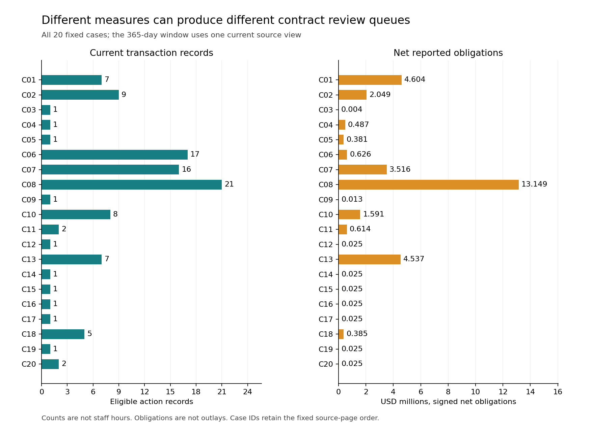

# Contract action counts and net obligations

A contract review queue built from net obligations answers a different question from one built from transaction counts. This study keeps both measures visible in a fixed current-source cohort of 20 NASA contracts first obligated in 2024.

**Finding:** the two five-contract queues share three cases. The declared 365-day windows contain 104 current transaction records, including 12 zero-dollar actions and three negative obligations. Count-based and dollar-based views provide different information; neither has been validated as a staffing measure.

## Practical use

Keep source-action counts, zero and signed adjustments, gross obligations and net obligations beside each other. Use the [complete case accounts](results/case_accounts.csv) and [both queues](results/queue_ranks.csv) to inspect the difference. Collect measured review tasks and time before using these fields to allocate staff.

The local [implementation exercise](EXERCISE.md) returns qualified current accounts and rejects requests to infer staff hours, vendor risk, pre-award features or future modifications. It is runnable code with seven complete requests, not a deployed workload system.

~~~powershell
python -m pip install -r requirements.txt
python src/replay.py --out ../contract-accounting-replay
~~~

Use a new output directory. The saved-data replay checks the freeze and source mapping, reproduces six result files, runs independent SQL/exact-rational checks and fixtures, and verifies figure geometry and the actual manuscript. It does not redownload mutable native sources.

## Evidence underneath

- [Six-page independent manuscript](paper/manuscript.pdf), [LaTeX](paper/main.tex) and three original figures. Not peer reviewed.
- [Every source-row classification](results/row_classification.csv), [all 60 fixed horizon probes](results/cumulative_probes.csv), [complete case accounts](results/case_accounts.csv), [all queue ranks](results/queue_ranks.csv), [summary](results/summary.json) and [seven requests](results/exercise.json).
- [Fixed protocol](PROTOCOL.md), [24-dependency freeze](PLAN_FREEZE.json), [source meanings](data/README.md), [capture manifest](data/capture_manifest.json), [native verification](data/native_verification.json) and [data rights](DATA_RIGHTS.md).
- Native reconciliation: 1,768 finite conditions across 153 current records and 62 responses. Saved-source checks: 1,236. Independent complete accounting/probe/rank/request checks: 1,582. All 33 authored fixture methods pass, including whole duplicate-group quarantine, unknown money, 364/365-day boundaries, same-day ambiguity, exact decimal spans and tied ranks.
- Separate full-history CPython [3.10.11](results/reproduction_cpython310.json) and [3.12.14](results/reproduction_cpython312.json) replays reproduce six files exactly; all nine source-directory files remain unchanged in each.
- [Figure verification](figures/verification.json): 120 source-bound bars, 480 actual SVG coordinate conditions, nine asset hashes and 1,094 finite conditions. [Paper verification](paper/verification.json): 158 used source bindings, all 20 actual PDF table rows, current replay hashes and 698 conditions. All six rendered pages were inspected.

## Scope and limits

This is a source-informed first-page convenience cohort from one agency and one base year. Selection and 365-day windows were fixed before capture; 24 actual source/method dependencies were committed before comparisons. Current source values were visible during capture and reconciliation, so the study is not blinded.

The captured source has 153 rows: 104 fall inside the fixed windows and 49 are on or after their endpoints. The complete financial windows retain signed and zero values. C02's net-offset fraction is 31.57%; C08's is 3.95%. Those ratios measure offsetting signed obligations, not waste, savings or cash recovery. The full ledger retains all cases, including zero offset.

A source transaction is not automatically a distinct legal modification or staff task. Obligations are not outlays or paid cash. Calendar dates cannot order same-day records. Current count agreement does not establish atomicity, historical completeness, original publication or pre-award feature availability.

The [original pre-award classifier remains unexecuted](SOURCE_HISTORY.md). No vendor-risk ranking, fraud claim, staff-hour estimate, national rate, classifier accuracy, causal effect, production use or realized saving is claimed.

Only minimal public government transaction facts and independent results are published. Native narratives, recipient information and source PDFs remain private. Separate formal-publication projects, including Azure optimization, remain private.

Source: U.S. Department of the Treasury, USAspending.gov API v2, captured 31 October 2026 UTC. Exact requests, times and hashes are retained. Treasury does not endorse this independent analysis. Original code is MIT licensed; agency facts are attributed separately.
